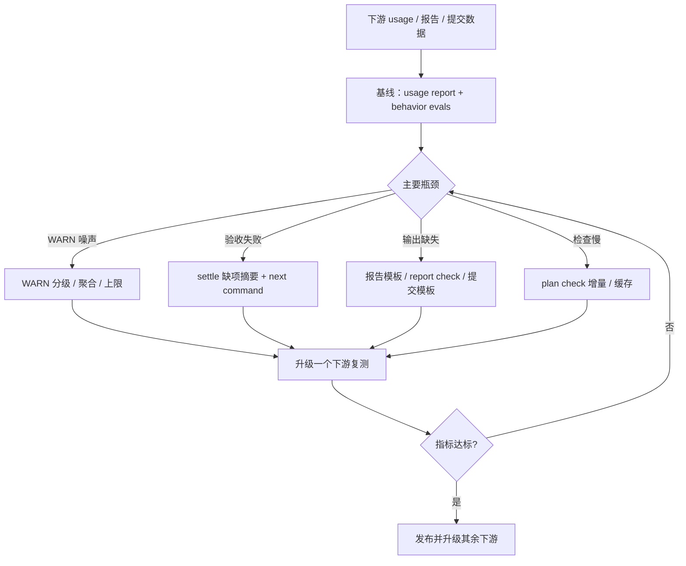

> 状态：已实施-仅追溯（代码已是真源，2026-10-22 核对）
> 最近修订：2026-10-22 — mobile 已升级 2.31.0 并提交，剩余 behavior 第二轮与指标复测
<!-- docs-harness:plan-document/v1 -->

# Docs Harness 遵循率优化：从下游数据到可执行契约

- 冻结合同：`sha256:127777df4cc964afe81d4aa95e71abc7613c63280cb2c80ea29a0f1e662218c2`
- 关键符号：`run_assets_check`、`build_report`、`symbol_hit`、`plan_check_banner`

## 背景

8 个下游在 2026-09-14 至 10-22 共有 1,669 次 harness 调用。assets-check 493/718 次有 WARN（69%），zbuddy-desktop 355/373（95%）；10-14 后真实失败 36/172（21%），zbuddy-mobile 最近 70 次中 25 次 exit 1/2，集中在 acceptance settle/record；10-14 后 96 份收尾报告五项字段齐全仅 8 份；134 个代码提交中同时含「验证/未覆盖」107 个（80%）。用 2.31 源码检查 mobile 产生 88 条 WARN，其中 79 条是 CODEMAP 误报，已修复到 4 条。

## 目标

在不做完整提示词分层的前提下，把遵循率优化落到可测量、可执行、可回归的系统能力：降低误报与 WARN 噪声，减少 acceptance 闭环摩擦，把收尾/提交要求变成模板和检查，缩短大型下游的检查时间，并建立持续指标与 behavior 基线。

## 非目标

不做完整提示词分层；不靠继续增加提示词条款解决遵循率；不批量重写下游历史方案或 CODEMAP；不新增第三方依赖；不在未获用户确认前添加强制 commit-msg 钩子；不改变默认直跑与高风险原生授权。

## 成功标准

- 检查器：mobile/desktop 无新增误报；每次 assets-check 的可行动 WARN 不超过 5 条，WARN>0 的运行占比目标 mobile <20%、desktop <30%。
- 验收：zbuddy-mobile 10-14 后 acceptance settle/record 的 exit 1/2 次数下降 50% 以上；pending 验收的缺项能在一次命令输出内看全。
- 输出：新收尾报告五项字段齐全率达到 80%；代码提交同时含「验证/未覆盖」达到 95%（若 commit 钩子获批）。
- 性能：zbuddy-desktop 的 plan check 增量模式 <30 秒；全量模式有明确缓存或分段。
- 测量：usage report 增加 warn_rate、按命令真实失败率、报告字段完整率；behavior evals 11 条/52 检查点有基线记录和前后对比。

## 执行范围

scripts/usage_report.py、asset_checks.py、plan_check.py、structure_check.py、acceptance_assets.py、managed_assets.py、harness.py、scripts/agent_prompt.md、docs/*、tests/*；按批次改动，不一次性重写。

## 执行内容

B0 测量基线：扩展 usage report 指标；建立 behavior evals 基线；记录当前下游数字。
B1 检查器降噪：WARN 分级（可行动/提示）、聚合去重、输出上限与 --verbose；已完成符号误报修复，剩余为 plan/ADR/structure 噪声治理。
B2 验收闭环：acceptance settle/record 失败时返回 missing criteria、pending 原因和下一步命令；增加 pending 验收摘要；复测 mobile。
B3 输出契约：提供收尾报告固定模板与 report check（或等价校验），统一「验证层级」；评估 commit-msg 模板，获确认后实施。
B4 计划状态与性能：plan check 增量/缓存，桌面 <30s；为「符号已全部落地」提供 partial banner 更新或 settle 建议。
B5 集成与发布：在 zbuddy-mobile/desktop 只读复测，升级一个下游，比较指标，更新 CHANGELOG、文档、CODEMAP 与测试。

## 执行进度

```json
{
  "completed_steps": [
    "检查器符号误报与 ADR 状态备注降噪：mobile 88→4",
    "B0 usage report adherence/report_completeness 指标与基线",
    "B1 WARN 分组摘要、5 条预览与 --verbose；去注释 token 批量匹配",
    "B2 acceptance settle/record 缺项诊断与 acceptance list pending 摘要",
    "B3 report check 五项字段校验；受管入口统一验证层级",
    "B4 plan check 从 130 秒降到约 6 秒；mobile 约 1 秒",
    "behavior evals 第 1 轮基线：11 条/52 检查点，复测后 49/52；native-risk 初跑失败后补强确认规则并复测通过",
    "zbuddy-mobile 升级 2.31.0 并提交 7c57951，project check 为 passed/in_head"
  ],
  "remaining_steps": [
    "behavior evals 第 2 轮全量复测与逐项 52 检查点裁决",
    "下游升级后 3–7 天失败率/WARN 率/报告完整率复测",
    "B5 最终结算与发布"
  ]
}
```

## 流程图



## 体验/操作者路径

下游 agent 完成一次代码改动：assets-check 只给出少量可行动 WARN；acceptance settle 失败时一次看到缺项和下一步命令；收尾按模板填写，report check 通过；提交说明带验证/未覆盖。维护者用 usage report 看到 WARN 率、真实失败率和报告完整率，按周比较；升级一个下游后，用同一组指标验证 2.31 是否真正降低摩擦，而不是靠主观感受。

## 模块划分与接口骨架

usage_report.build_report：新增 adherence 组（warn_rate、real_failure_rate、command_failures）。
asset_checks.run_assets_check：WARN 增加 severity/group 字段，输出聚合摘要，保留完整列表供 --verbose。
managed_assets._normalize_projected_status（已落地）：状态比较忽略核对备注。
structure_check.symbol_hit（已落地）：去注释词边界匹配，兼容字段、枚举、类型标注赋值、环境变量与带点引用。
acceptance_assets.settle/record：错误 payload 增加 missing_criteria、pending_reasons、next_actions。
plan_check.plan_check_banner：增量模式按变更集与缓存选择文档；输出 partial banner 建议。
harness.py：扩展 usage report 与 report check；旧输出保持兼容。

## 验收方案

单元测试：WARN 分级/聚合、settle 缺项摘要、状态归一、符号匹配、usage 指标。
集成测试：临时下游跑 assets-check、plan check、acceptance settle，确认输出与退出码。
真实运行：zbuddy-mobile/desktop 只读复测；升级 mobile 后 3–7 天数据对比。
度量验收：success_criteria 中的指标；behavior evals 基线 + 改动后复测。

## 是否需要 Acceptance 资产闭环

```json
true
```

## Knowledge 影响

unchanged

## 约束

Python 3.9 标准库；不新增第三方依赖；下游当前主要在 2.30.0；高风险管理走原生授权；数据是观察性命令日志，不能单独证明规则因果。

## 风险与回滚

降噪会牺牲部分严格性（符号匹配可能漏掉注释中的真实失效）；WARN 上限可能隐藏问题，用 --verbose 和摘要计数补偿；commit 钩子提升遵循率但增加摩擦，需用户确认；检查增量优化需保留 CI 全量兜底。按批次独立提交，任一批次可单独 revert；性能缓存失效时回退全量扫描。

## 当前约束

Python 3.9 标准库；不新增依赖；下游版本以 2.30.0 为主；2.31.0 尚未发布；usage 日志只记录 harness 命令，不能观察直接任务或模型推理；收尾报告和提交是代理指标。

## 候选方案

1) 完整提示词分层：上下文更短，但规则可能不加载，数据不支持。2) 继续增加提示词条款：成本低，但当前问题是输出与噪声，边际收益低。3) 一次性清理所有下游 WARN：能降数字，但不建立持续机制。4) 只做检查器修复、不做测量：无法证明遵循率提高。

## 真实取舍

降噪减少误报，但可能降低对陈旧符号的敏感度；WARN 上限便于消费，但可能隐藏低频问题，用完整模式补偿；commit 钩子提高提交说明覆盖率，但增加操作摩擦；增量检查更快，但需要 CI 全量兜底。

## 最终决策

采用分阶段、测量优先方案；先做 B0/B1，任何提示词改动都必须有 behavior 基线对比；不做完整提示词分层。

## 边界与接口

新增输出字段与命令保持向后兼容；默认直跑、Plan/Acceptance 语义不变；WARN 分级不改变 strict 的失败判定；不改变 managed files 安装面，除非 B3 新模板需要同步安装清单。

## 兼容与迁移

2.31.0 未发布，本方案作为 2.31.x/2.32 候选；下游从 2.30 升级后会有 AGENTS 受管区块 diff；usage/report 新字段为新增键；不迁移历史数据；旧版命令输出保留。

## 回滚或替代路径

按批次独立提交，任一批次可单独 revert；新增行为用参数或模式隔离，默认保持现有语义；performance cache 失效时回退全量扫描；commit 钩子若造成阻塞可移除。

## 架构验收

不新增第三方依赖；检查器输出契约有测试；B0 指标能在真实下游复现；B1/B2 对 mobile 的指标有前后数字；B4 有 desktop 基准；B5 全量回归与 assets-check --strict 通过。

## ADR 处理

本方案沿用现有架构决策，不新增 ADR。若 B3 最终采用 commit-msg 强制检查，因其改变下游提交契约，单独登记 ADR 后再实施。

<!-- docs-harness:plan-governance:start -->
## 资产治理

- 关联验收：`docs/acceptance/harness-adherence-optimization.json`
- 需要 Acceptance：true
- Knowledge 影响：unchanged
<!-- docs-harness:plan-governance:end -->
