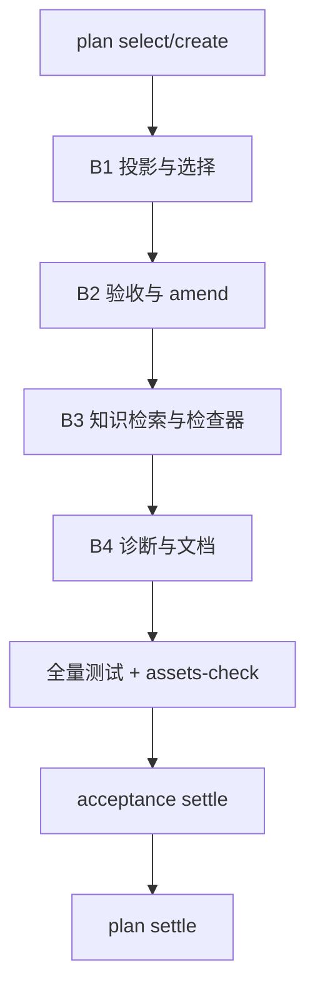

> 状态：已实施-仅追溯（代码已是真源，2026-10-21 核对）
<!-- docs-harness:plan-document/v1 -->

# Harness P0/P1 修复：执行投影、选择流程与验收闭环

- 冻结合同：`sha256:1d1da273c90e35e3a904f9008db352fdd4d6eb4444410cec2ed7a08bd4767443`
- 关键符号：`execution_projection`、`plan_show`、`acceptance_amend`、`symbol_hit`

## 背景

审查发现：执行投影只保留少量内容字段；同一合同因 reason 不同产生不同 selection 指纹；acceptance record 未关联资产时仍报成功，deprecated acceptance 可满足 Plan 门禁；plan amend 不能改治理声明；knowledge 检索按路径顺序；检查器用子串匹配；文档版本漂移；当前工作区 test_cli_surface 有失败。

## 目标

修复 P0/P1，保持默认直跑、零第三方依赖和 Python 3.9 兼容，让长任务执行者拿到完整冻结内容，并让验收与检查结果更可信。

## 非目标

- 不做 P2 的 prompt 分层
- 不完整拆分 harness.py
- 不引入第三方依赖
- 不提升版本号
- 不改默认直跑边界

## 成功标准

- P0/P1 行为有聚焦测试与全量测试证据
- plan select/create/show 新流程可用
- acceptance 假成功与门禁漏洞有测试覆盖
- knowledge 排序、过期、冲突与约束有测试
- 符号与索引投影检查有测试
- 文档版本一致，assets-check --strict 通过（既有 WARN 单独归因）

## 执行范围

- scripts/harness.py
- scripts/plan_governance.py
- scripts/plan_amend.py
- scripts/acceptance_assets.py
- scripts/knowledge_assets.py
- scripts/adr_assets.py
- scripts/structure_check.py
- scripts/managed_assets.py
- tests/
- docs/
- AGENTS.md
- SKILL.md
- README.md
- CHANGELOG.md

## 执行内容

B1 投影、plan show、选择流程；B2 验收闭环与 amend；B3 知识检索与检查器；B4 错误诊断、CLI 参数边界与文档基线。每批聚焦测试通过后锁定，最后跑全量测试与 assets-check。

## 流程图



## 体验/操作者路径

Agent 先用 plan show 读取冻结内容；按 B1-B4 执行，每批结束跑聚焦测试；失败时按错误中的 next_action 修复；收尾用 acceptance record 记录证据，settle acceptance，再 settle plan。

## 模块划分与接口骨架

harness.py：plan show、selection 解析、错误聚合、flag 边界；plan_governance.py：合同指纹、selection 校验、治理 amend；plan_amend.py：amend 返回 projection；acceptance_assets.py：acceptance amend；knowledge_assets.py：排序查询、source_ok、constraints；adr_assets.py：活跃约束；structure_check.py：symbol_hit、--base；managed_assets.py：索引/横幅投影校验。

## 验收方案

acceptance create 建立 B1-B4 四个 criterion；每批测试通过后 record；全部 passed 后 settle，再 plan settle implemented。

## 是否需要 Acceptance 资产闭环

```json
true
```

## Knowledge 影响

unchanged

## 约束

不新增依赖；不改变默认直跑；不删除既有资产；所有写操作保持原子写入。

## 风险与回滚

风险：契约变更、旧 selection 失效、新增检查影响下游；回滚：按批 revert，重跑 select，必要时将新检查降为 WARN。

## 当前约束

Python 3.9 兼容；零第三方依赖；当前工作区 HEAD 2.28.0，已有未提交的 2.30.0 改动；harness.py 已超测试体积上限；旧 plan selection 缓存可能失效。

## 候选方案

- 只修文档与测试，不修行为
- 只修 P0，不修 P1
- 完整重构 CLI 与 harness.py（超出 P0/P1 范围）
- 按 P0/P1 分四批修复（选择）

## 真实取舍

契约变更会带来兼容成本；新增 CLI 参数比 per-action 子解析器风险低；索引/投影校验先以 WARN 暴露，避免下游一次性全部变红。

## 最终决策

采用分批修复；selection 使用合同指纹；新增 plan show 与 acceptance amend；plan amend 允许带 reason 修改治理声明；错误聚合与 flag 边界用最小侵入实现。

## 边界与接口

CLI 新增 plan show、acceptance amend；plan create 新增直接 level/profile/complexity 参数；execution_projection 为完整 content；knowledge query 增加 constraints/source_ok/omitted；structure check 增加 --base。

## 兼容与迁移

旧 plan selection 文件可能因新增合同指纹与 required 语义失效，需重跑 plan select；新增命令与字段为加法；plan amend 治理变更必须给 reason；资产存储路径不变。

## 回滚或替代路径

按批 git revert；旧 selection 缓存可删除后重跑；若新增索引/投影检查引起下游噪音，先降级为 WARN 或移除该检查。

## 架构验收

每批聚焦测试；全量 npm test；assets-check --strict；CLI smoke 覆盖 plan select/create/show/amend/settle、acceptance create/amend/record/settle、knowledge query、structure check --base。

## ADR 处理

不新增 ADR；本次是现有资产合同的修正，不改变分层、存储边界或零依赖约束。若实施中出现新的长期架构取舍，再单独 adr create。

<!-- docs-harness:plan-governance:start -->
## 资产治理

- 关联验收：`docs/acceptance/harness-p0-p1-fixes.json`
- 需要 Acceptance：true
- Knowledge 影响：unchanged
<!-- docs-harness:plan-governance:end -->
