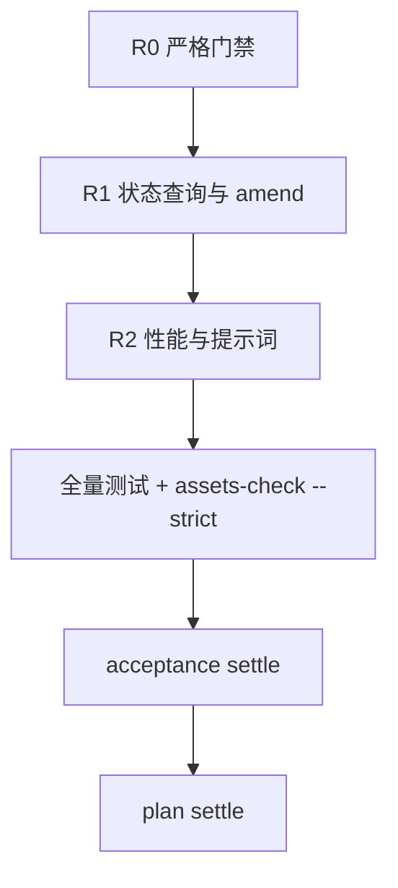

> 状态：已实施-仅追溯（代码已是真源，2026-10-22 核对）
> 最近修订：2026-10-22 — 把 Plan 文案与实际交付对齐：show/list、git 扫描、source 缓存
<!-- docs-harness:plan-document/v1 -->

# Harness 剩余优化：严格门禁、状态查询与规模化

- 冻结合同：`sha256:32afe92331566147f04dc527f8b64c04f579e48d0ffaf5f002f441e15ac68a35`
- 关键符号：`plan_check`、`acceptance_show`、`document_knowledge_query`、`asset_query`

## 背景

P0/P1 修复后仍有 7 条 Structure WARN 使 assets-check --strict 红；Agent 只有 plan show，缺少 acceptance/knowledge/adr 查询；amend 仍要整包重填，dry-run 只覆盖 create；CLI 有重复 flag；检查器策略仍偏启发式；全仓扫描与知识检索在规模上有风险；受管提示词仍嵌在 harness.py 内；Windows python3/BOM 仍会绊住首次运行。

## 目标

完成 P0/P1/P2 剩余优化：严格门禁转绿、补齐只读状态面与 amend/dry-run、收敛 CLI 与检查器、提升扫描/知识检索效率、提示词外置与平台兼容，并保持默认直跑、零第三方依赖和 Python 3.9 兼容。

## 非目标

- 不提升版本号（除非确认 2.30.0 已发布）
- 不引入第三方依赖
- 不改变默认直跑边界
- 不做与本次无关的资产模型重设计

## 成功标准

- assets-check --strict 退出码 0
- 新增 show/list 命令并有聚焦测试
- plan/acceptance 支持部分 amend 与 dry-run
- 知识查询有段落片段与 source 缓存测试
- 提示词外置为受管模板且 AGENTS 同步
- Windows 启动/BOM 路径有说明或测试
- 全量测试通过

## 执行范围

- scripts/harness.py
- scripts/plan_check.py
- scripts/acceptance_amend.py
- scripts/cli_support.py
- scripts/agent_prompt.md
- scripts/structure_check.py
- scripts/knowledge_assets.py
- scripts/adr_assets.py
- tests/
- docs/
- AGENTS.md
- SKILL.md
- README.md
- package.json
- CHANGELOG.md

## 执行内容

R0 拆分与严格门禁：提示词外置、plan_check/acceptance_amend/cli_support 模块化、拆分大函数与测试、更新安装清单；R1 状态查询与 amend/dry-run：show/list、partial amend、dry-run、record 聚合、CLI 冲突检测、检查器策略；R2 性能与提示词：git 扫描、知识片段/source 缓存、提示词分层、Windows/BOM。

## 流程图



## 体验/操作者路径

Agent 先用 show/list 查看资产与下一步；需要修改时用 partial amend 并先 dry-run；长任务用 show 恢复；收尾按 R0-R2 记录 acceptance，最后 settle。

## 模块划分与接口骨架

harness.py 保留 CLI 编排；plan_check.py 负责 Plan 文档卫生检查；acceptance_amend.py 负责 pending 验收修订；cli_support.py 负责 action flag 边界；agent_prompt.md 是受管提示词模板；structure_check.py 继续承担符号/体量检查。

## 验收方案

acceptance create 建立 r0.strict_gate、r1.state_and_amend、r2.scale_and_prompt 三个 criterion；每批聚焦测试后 record，全部 passed 后 settle，再 plan settle。

## 是否需要 Acceptance 资产闭环

```json
true
```

## Knowledge 影响

unchanged

## 约束

不新增依赖；不改变默认直跑；不删除既有资产；所有写操作保持原子写入。

## 风险与回滚

风险：模块拆分导致安装/升级指纹漂移、提示词分层影响行为、性能改动改变排序结果；回滚：按批 revert，保留旧的单文件实现作为临时回退。

## 当前约束

Python 3.9 兼容；零第三方依赖；工作区已有未提交的 2.30.0 改动；strict 已恢复 0 失败 0 警告；新增受管文件需要刷新安装指纹。

## 候选方案

- 接受 strict WARN，不做拆分
- 只补 show/list，不做 amend/dry-run
- 只做性能与知识质量，不动提示词
- 按 R0-R2 分批完成（选择）

## 真实取舍

模块拆分增加安装清单与指纹维护成本；新增命令扩大 CLI 面；partial amend 降低 token 但需要明确合并语义；提示词分层可能影响行为评测。

## 最终决策

按 R0-R2 分批；R0 先恢复 strict 绿；R1 用加法命令与可选 dry-run；R2 用 git 索引与模板外置，逐步验证。

## 边界与接口

新增模块与 prompt 模板纳入受管安装清单；新增命令为加法；不改变现有资产路径与默认直跑。

## 兼容与迁移

新增受管文件需要 project upgrade 安装并刷新指纹；旧项目升级后 AGENTS 受管区块会更新一次；新增 flag/命令不影响旧调用。

## 回滚或替代路径

按批 revert；新增模块可整体移除；strict 拆分若引入回归，先恢复单文件版本再排查。

## 架构验收

每批聚焦测试；全量 npm test；assets-check --strict；安装/升级指纹测试；CLI smoke。

## ADR 处理

不新增 ADR；本次是现有模块边界与 CLI/提示词交付方式的整理，不改变分层与零依赖约束。

<!-- docs-harness:plan-governance:start -->
## 资产治理

- 关联验收：`docs/acceptance/harness-remaining-optimizations.json`
- 需要 Acceptance：true
- Knowledge 影响：unchanged
<!-- docs-harness:plan-governance:end -->
