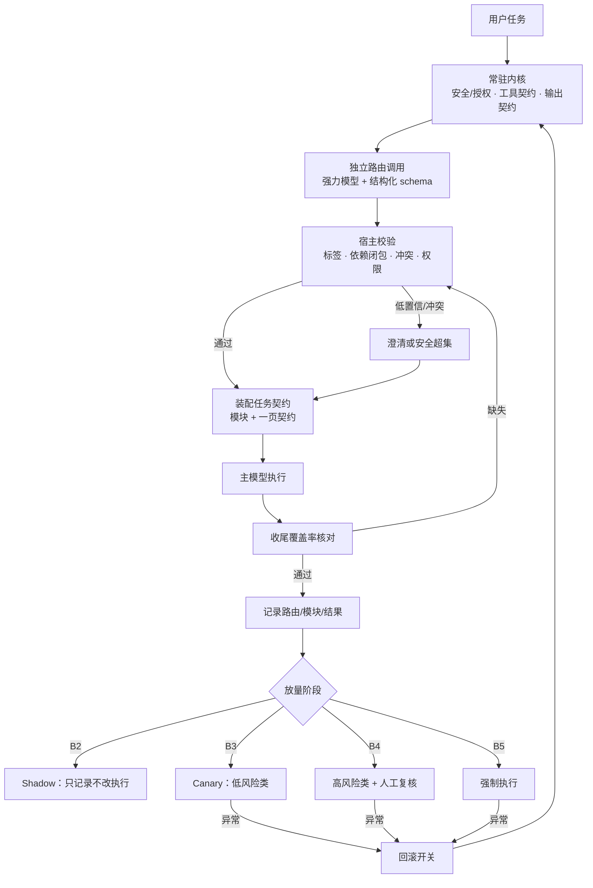

> 状态：有效（实施中）
<!-- docs-harness:plan-document/v1 -->

# 强力模型意图路由落地：Shadow → Canary → 强制执行

- 冻结合同：`sha256:c72a71a21bf8d73883b138477d7cb4bd031b8b6cebc2906d11a6e526f480a4fd`
- 关键符号：`score_cases`、`interpret_response`、`command_assets_check`、`run_assets_check`

## 背景

当前 Docs Harness 的受管入口把全部规则常驻在上下文中，简单任务也要承担约 6k token 的无关规则。规则基线和 Jev 的评测表明：纯关键词规则在诊断集错配 55%、held-out 错配 46%；Jev 1.14.0 在诊断集 v2 为 5%，但 held-out 为 24% 错配、14% 关键漏配，诊断集的 5% 没有泛化。强力模型直路由在两组各 50 条 held-out、四次独立运行中标签一致，意图和模块均为 100%；但这批用例是引导式、同一模型家族编写的 curated 集，生产调用路径、成本、延迟和真实返工都还没有数据。因此本方案不是直接全量上线，而是把强力模型作为执行前的独立路由层，先补齐契约、校验、日志，再按 shadow → canary → 强制执行放量。

## 目标

在不改动执行行为的前提下，先建立可校验、可观测、可回滚的强力模型路由层；用 shadow 和 canary 的真实数据证明关键契约不漏、无关模块减少、返工不高于当前，再逐步替换旧的规则/Jev 路径。最终目标是降低无关指令稀释、减少提示词 token 和路由返工，同时保留常驻内核的安全、授权和输出契约。

## 非目标

不在 B1/B2 改变执行行为；不对模型做微调或 LoRA；不移除安全、授权、权限和不可逆操作确认；不改变现有 CLI 命令契约、Plan 模板字段和下游安装面；不在本方案内把路由器安装到下游项目；不在已消费的诊断集/held-out 上继续调阈值；不在没有真实日志前宣称生产准确率；不默认删除 Jev，B5 再决定是否移除。

## 成功标准

离线层：关键契约召回率接近 100%，关键漏配不高于当前基线；模块精确率和过度路由率优于当前；澄清率可解释且不被用户视为额外负担。Shadow 层：100% 任务有路由决策日志；关键漏配不高于当前行为；返工事件（取消、重准入、范围纠正、多余生命周期命令、验收失败）不高于基线；p95 路由延迟和单任务 token 成本在预算内。Canary 层：低风险类（answer/docs/code）的用户纠正和返工不高于当前；可一键回滚。强制层：高风险类（plan/assets/release）保留人工复核和覆盖率核对；关键契约缺失能被收尾检查发现并阻断或修复。

## 执行范围

仓库侧：路由注册表、profile JSON schema、宿主校验库、shadow 日志读写与指标聚合、覆盖率检查、契约测试和运维文档；复用 evals/intent_routing 的评分器和现有 usage/report 设施。宿主侧（本仓外，前置条件）：提供独立、低上下文的强力模型调用；把路由结果注入执行上下文；提供 feature flag、shadow 日志和回滚开关。下游侧：本方案不安装路由器；2.33.0 的提示词规则升级已独立完成。若宿主无法提供独立低上下文调用，B0 停止，改为同轮两段式路由并重新定义验收指标。

## 执行内容

B0 就绪审计（不改行为）：确认宿主能否独立调用强力模型并返回结构化 JSON；确认 token、latency、model/version 可记录；确定注册表版本、日志字段、指标口径和隐私脱敏；建立 20–50 条真实任务的基线样本。B1 契约与校验：新增路由注册表（taxonomy、7 意图、6 模块、10 触发项、意图→模块映射、一页契约、版本和指纹）；新增纯校验函数：标签合法性、依赖闭包（bug_fix→code，其他按映射）、冲突消解（answer_only 与动作意图互斥、plan/code 共存规则）、去重、clarity 检查；新增 shadow 事件结构与写入/读取；全部默认关闭，执行行为不变。B2 Shadow（1–2 周）：每条真实任务并行调用路由器，记录意图、模块、触发项、置信度、模型版本、tokens、latency、实际加载模块、用户澄清和返工事件；不改变执行；每日/每周生成对比报告；关键漏配、过度路由、澄清率和返工超过阈值就修契约或停止。B3 Canary 低风险类：先对 answer/docs/code 打开路由，宿主编排仍做依赖闭包、冲突消解和覆盖率核对；保留一键关闭；对比 canary 与 shadow/基线的返工、澄清、延迟和成本。B4 高风险类：对 plan/assets/release 打开路由，但关键任务保留人工复核或 high-risk 二次确认；覆盖率缺失时阻断并记录，不允许静默执行；对交叉场景（代码+发布、方案+验收）做交叉点合同测试。B5 强制执行与清理：全部维护中任务走强模型路由；保留内核和覆盖率核对；评估是否移除 Jev/旧规则路径；完成 Acceptance 结项、Knowledge 更新和 ADR 定稿。每批都要先落骨架和接口签名，再填逻辑；批次验证通过后锁定，不回头改已锁定批次。

## 执行进度

```json
{
  "completed_steps": [
    "100 条 curated 评测（20 诊断 + 两组各 50 held-out）",
    "2.33.0 发布与 10 个下游升级"
  ],
  "remaining_steps": [
    "B0 宿主能力审计与基线",
    "B1 路由契约/校验/日志",
    "B2 Shadow",
    "B3 Canary 低风险类",
    "B4 高风险类",
    "B5 强制执行与旧路径清理"
  ]
}
```

## 流程图



## 体验/操作者路径

最终用户：在 shadow 阶段完全无感，任务仍按当前行为执行；在 canary 阶段，answer/docs/code 类任务多一次后台路由调用，用户通常只感知到更少的无关流程；只有在目标、交付物或范围确实不清时，才会收到一个澄清问题，且不会因为路由不确定而连续追问。若路由器超时或返回非法 JSON，宿主回退到当前行为并记录，不把内部错误暴露给用户。操作者/维护者：从任务入口看到路由决策、置信度、模块和覆盖率；在 shadow 报告中按任务类型查看关键漏配、过度路由、澄清率和返工；发现异常时先修契约或阈值，必要时关闭 feature flag 回滚；canary 和强制阶段保留一键回滚和日志留存。错误态：路由不可用→回退；profile 非法→拒绝并记录；覆盖率缺失→阻断/修复；高风险任务→人工复核；日志缺失→按失败处理，不静默放行。

## 模块划分与接口骨架

仓库侧新增/修改：
1) routing/registry.json（数据，单点真源）：taxonomy、intent→module 映射、一页契约、优先级、版本/指纹、clarify 与 direct_override 规则。
2) scripts/routing_contract.py：`load_registry(path) -> Registry`、`validate_profile(profile, registry) -> ValidationResult`、`resolve_modules(profile, registry) -> list[str]`、`profile_schema(registry) -> dict`；纯函数，无模型调用。
3) scripts/routing_shadow.py：`append_shadow_event(event, path) -> None`、`read_shadow_events(path) -> list[ShadowEvent]`、`build_shadow_event(task_id, profile, actual_modules, outcome) -> ShadowEvent`；只写本地/受管日志，含脱敏。
4) scripts/routing_metrics.py：`summarize_shadow(events) -> ShadowSummary`（关键漏配、过度路由、澄清、返工、p50/p95、token），`coverage_check(profile, loaded_modules) -> CoverageResult`。
5) 复用 evals/intent_routing/score.py 的 `score_cases` 做离线评分，复用 evals/intent_routing/jev_predict.py 的 `interpret_response` 做 Jev 对照；不复制评分逻辑。
6) scripts/harness.py 在 B1 不新增命令面；如后续需要 `routing report`，只读聚合，不改执行路径。
宿主侧（本仓外）：`route_task(request, metadata) -> RoutingProfile`（独立低上下文调用）、`render_contracts(profile) -> list[Message]`（developer 消息）、`feature_flag`、`shadow_sink`、`rollback()`。宿主只信任校验后的 profile，不直接执行模型原始输出。

## 验收方案

离线验收：用 100 条 curated 和一组未消费的 fresh held-out（至少 50 条）跑离线评分；关键契约召回率接近 100%，关键漏配≤当前基线，过度路由低于当前，澄清率可解释；至少两次独立运行，记录标签一致性和置信区间。Shadow 验收：1–2 周真实任务，100% 有日志；按任务类型和风险级别分组统计关键漏配、过度路由、澄清率、p95 延迟、token 成本和返工事件；关键漏配或返工高于基线即停止。Canary 验收：answer/docs/code 类先切，比较用户纠正和返工；出现系统性异常立即回滚。强制验收：plan/assets/release 类保留人工复核和覆盖率核对；关键任务覆盖率缺失必须阻断；完成 Acceptance 逐条记录、Knowledge 更新和 ADR 定稿。

## 是否需要 Acceptance 资产闭环

```json
true
```

## Knowledge 影响

updated

## 约束

宿主必须能发起独立、低上下文的模型调用，并能记录 model/version、tokens、latency；否则 B0 停止并改方案。路由器只接收 taxonomy、一页契约和任务文本，不接收完整 AGENTS.md/目录；内核的安全、授权、权限和不可逆确认始终常驻。B1/B2 不得改变执行行为，feature flag 默认关闭。日志必须脱敏、只本地/受管存储，不写用户敏感内容；路由输出必须经过宿主校验，不能直接信任 JSON。不得在已消费的 held-out/诊断集上调阈值；新阈值只在 fresh set 或真实 shadow 数据上校准。不新增第三方依赖；不改变 CLI 契约；不高风险动作不做自动化放行。

## 风险与回滚

主要风险与处置：① 关键契约漏配（静默失败）→ 覆盖率核对、关键子集、关键漏配接近 0 才放量，异常立即回滚；② 误澄清/过度澄清→clarify 联合门、shadow 基线、canary 体验观察；③ 过度路由→模块精确率/禁止模块、宿主冲突消解；④ 宿主无独立调用→B0 停止，改同轮两段式并重定指标；⑤ 模型锚定/自偏好→独立调用、候选只作信号、证据化复核、抽检 accept 决策；⑥ 缓存/前缀失效→契约追加到尾部，不改系统前缀，记录 cache 命中；⑦ 成本/延迟→p95 和 token 预算，shadow/canary 超预算回滚；⑧ 中文/领域偏差→双语/真实样本复测、置信度和人工复核；⑨ 提示注入/不可信内容→注册表受控、输出校验、日志审计；⑩ 日志隐私→脱敏、保留期、访问控制；⑪ 注册表/契约漂移→版本指纹、drift 测试、覆盖率；⑫ 模块交叉冲突→优先级和交叉点合同测试；⑬ canary 任务分布漂移→分层抽样和周期性复测。回滚：关闭 feature flag，恢复当前 kernel/规则行为；保留 shadow 日志和已装配契约；无数据迁移、无下游回滚；高风险任务人工复核。

## 当前约束

强力模型直路由只有离线、引导式、同模型家族的 100 条 curated 证据；生产宿主是否支持独立低上下文调用尚未确认；没有真实任务的成本、延迟、返工和缓存数据；Jev 的 held-out 24% 错配/14% 关键漏配说明单一模型或单层阈值不可靠；现有 AGENTS.md 约 6k token，简单任务承担无关规则；下游已升级到 2.33.0，但路由器尚未安装。

## 候选方案

A. 继续纯规则/关键词路由：实现便宜，但诊断集 55%、held-out 46% 错配，否决。B. Jev 单独路由：成本低，但 held-out 24% 错配、14% 关键漏配，否决作为默认。C. 强力模型直路由 + 宿主校验 + shadow/canary：准确率和可解释性最好，成本/延迟和宿主依赖是代价，推荐。D. Jev 预过滤 + 强力模型中间带复核：保留 Jev 成本优势，但多一层错误来源和复杂度，只有在成本/延迟成为硬约束时再评估。

## 真实取舍

准确性 vs 成本/延迟：强力模型每次多一次调用，但能显著降低错配和返工；用 shadow 量成本，用 canary 验证收益。模型能力 vs 宿主依赖：强模型直路由依赖宿主提供独立调用；若只能同轮内联，路由与执行混在一起，可审计性下降。分阶段放量 vs 速度：shadow 1–2 周会慢，但这是唯一能拿到真实返工数据的办法。引导式契约 vs 泛化：taxonomy/一页契约降低难度，也带来作者/同源偏差；必须用 fresh held-out 和真实日志校验。覆盖率核对 vs 延迟：多一步检查增加延迟，但能防止静默漏配。

## 最终决策

采用 C：强力模型作为执行前的独立结构化路由调用，宿主负责校验、依赖闭包、冲突消解和覆盖率核对；默认关闭，按 B1 契约/校验/日志 → B2 shadow → B3 低风险 canary → B4 高风险 + 人工复核 → B5 强制执行放量。内核安全/授权/输出契约常驻；路由器只选择任务契约；覆盖率缺失可阻断；任何阶段异常可一键回滚。

## 边界与接口

宿主与仓库边界：宿主拥有模型调用、上下文注入、feature flag、日志落盘和回滚；仓库拥有注册表、schema、纯校验函数、shadow 指标和离线评分。模型与代码边界：模型只输出意图画像/候选模块，代码负责映射、校验、依赖闭包、冲突和覆盖率；模型原始输出不作为执行依据。权威边界：内核安全/授权/权限/不可逆确认永远高于路由结果；路由结果只决定加载哪些任务契约。接口边界：注册表版本化；host `route_task`/`render_contracts`；repo `validate_profile`/`resolve_modules`/`summarize_shadow`/`coverage_check`。数据边界：日志脱敏、本地/受管、可审计；不把用户敏感内容写入共享日志。

## 兼容与迁移

不改变现有 CLI 命令、Plan 模板字段、资产流程和下游安装面；新增注册表/模块/测试为附加能力。B1/B2 默认关闭，现有行为完全兼容；B3 只对低风险类打开，保留开关；B4 对高风险类打开但保留人工复核；B5 才评估移除旧规则/Jev。下游项目已升级 2.33.0 的提示词规则，但本方案不向它们安装路由器；如需下游试用，另开计划并单独验收。

## 回滚或替代路径

一级回滚：关闭 feature flag，恢复当前 kernel/规则行为；shadow 日志继续保留，不影响用户。二级回滚：停止 canary 任务类型，清理未提交的装配，人工复核受影响任务。三级回滚：若注册表/校验引入系统性错误，回退到上一版本注册表并重放离线评分；不删除日志，不做数据迁移。高风险动作始终由原生授权/人工确认，路由回滚不涉及权限系统。

## 架构验收

架构层验收：注册表与 schema 可版本化、可 drift 检测；校验函数对非法标签、缺失依赖、冲突模块、越权输出有确定性拒绝；宿主与仓库边界清晰，模型输出不能绕过校验；shadow 日志能还原每次决策与实际加载模块；feature flag 能一键回滚；高风险类有覆盖率阻断和人工复核；离线、shadow、canary、强制四层证据分别记录，不用离线 100% 替代生产验收。

## ADR 处理

实施前新增 ADR：记录「强力模型意图路由 + 宿主校验 + shadow/canary」的决策、候选（规则、Jev、强模型、混合）、取舍、后果和回滚；ADR 定稿后不手改，后续修正用 adr amend，失效用 adr settle。Plan 与 ADR 交叉引用；B5 完成前 ADR 保持活跃。

<!-- docs-harness:plan-governance:start -->
## 资产治理

- 关联验收：`docs/acceptance/strong-model-routing-rollout.json`
- 需要 Acceptance：true
- Knowledge 影响：updated
<!-- docs-harness:plan-governance:end -->
